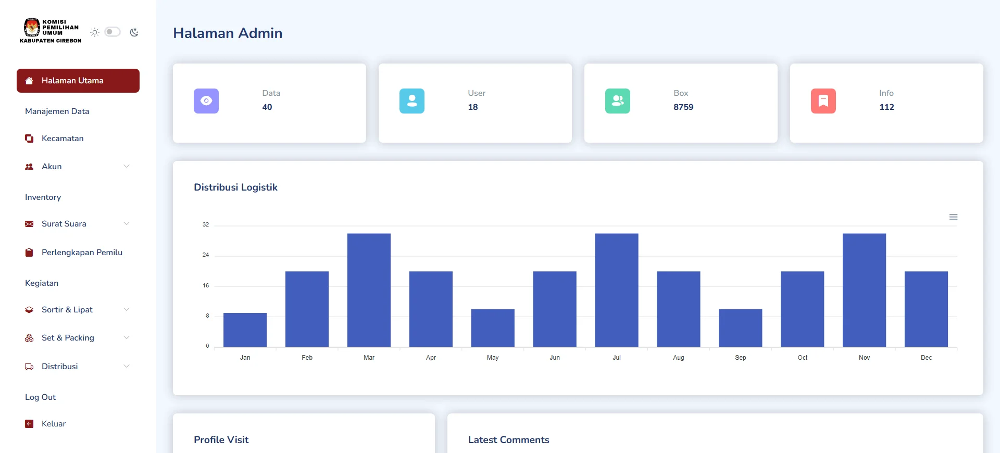
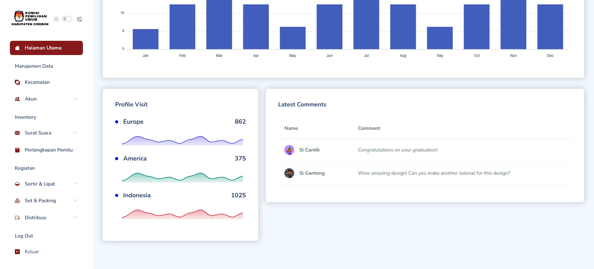
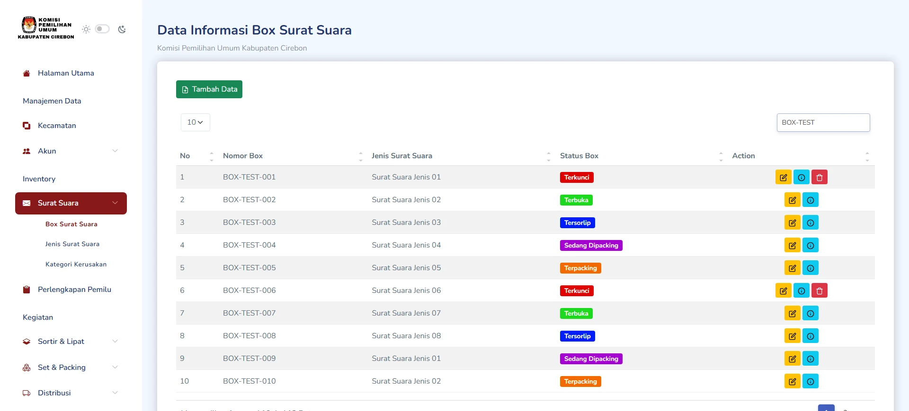
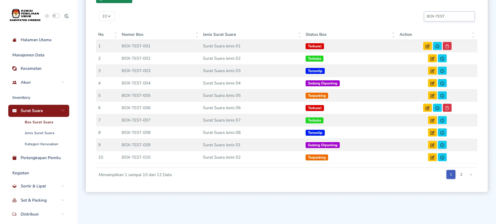
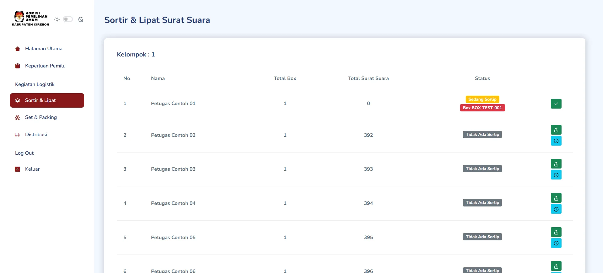
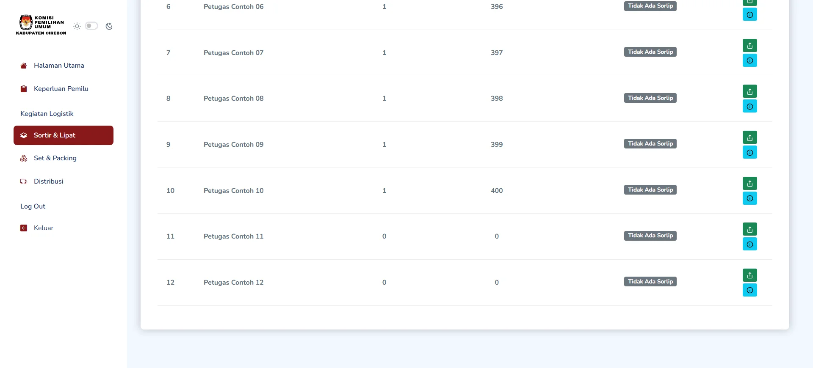
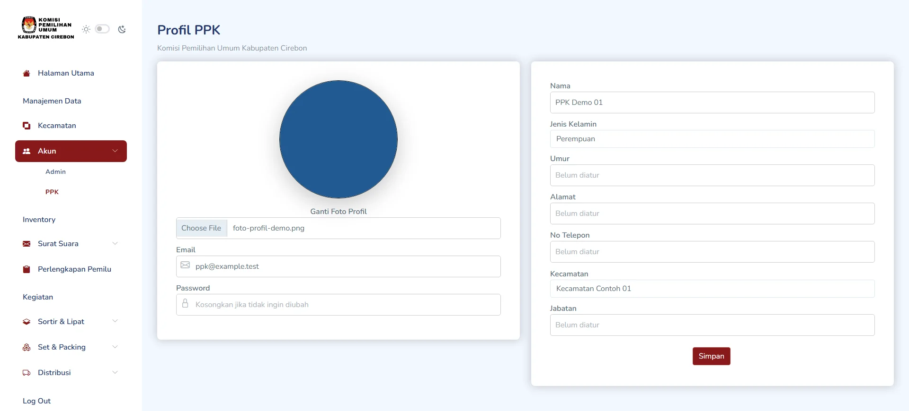
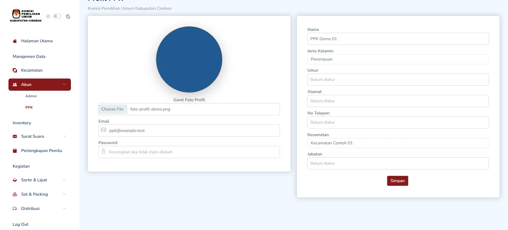
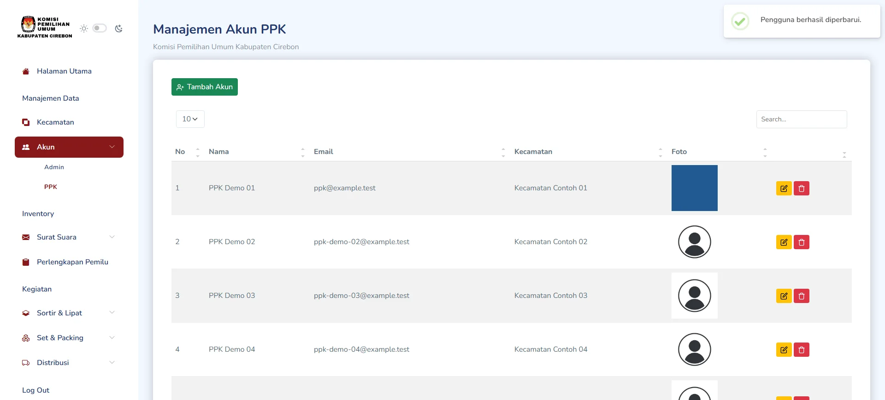
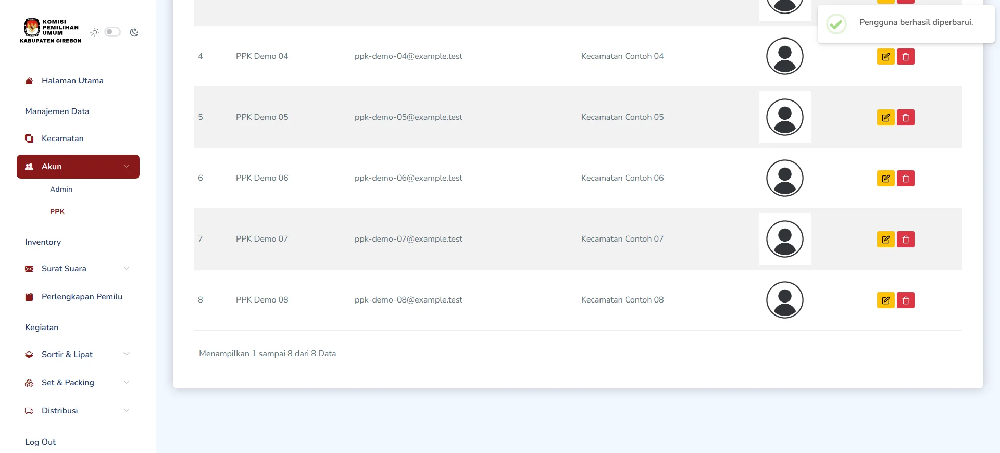

# Sistem Informasi Logistik KPU Kabupaten Cirebon

Aplikasi untuk mendukung pencatatan dan pemantauan proses logistik pemilu.


Repository: [IrvanAfriandi/sistem-logistik-kpu-kabupaten-cirebon](https://github.com/IrvanAfriandi/sistem-logistik-kpu-kabupaten-cirebon)

## Tentang Proyek

Aplikasi ini mendukung pengelolaan logistik pemilu untuk operator Admin dan PPK, termasuk pencatatan surat suara, perlengkapan, serta proses sortir, packing, dan distribusi. Proyek dibangun dengan Laravel 10 dan Blade, dengan antarmuka berbasis Mazer dan Bootstrap.

## Fitur Utama

- Dashboard administrasi sebagai pintu masuk modul logistik.
- Pencatatan box surat suara, jenis, dan statusnya.
- Manajemen akun PPK dan pengisian profil dengan foto.
- Halaman kerja PPK untuk memantau progres sortir-lipat.

## Tampilan Aplikasi


<p align="center"><em>Dashboard utama Admin untuk navigasi pengelolaan logistik.</em></p>

<table>
  <tr>
    <td align="center">
      
      <br><em>Dashboard utama Admin untuk navigasi pengelolaan logistik. (bagian lanjutan).</em>
    </td>
    <td align="center">
      
      <br><em>Daftar box surat suara dengan data uji dan pencarian aktif.</em>
    </td>
  </tr>
  <tr>
    <td align="center">
      
      <br><em>Daftar box surat suara dengan data uji dan pencarian aktif. (bagian lanjutan).</em>
    </td>
    <td align="center">
      
      <br><em>Halaman PPK untuk memantau progres sortir-lipat petugas.</em>
    </td>
  </tr>
  <tr>
    <td align="center">
      
      <br><em>Halaman PPK untuk memantau progres sortir-lipat petugas. (bagian lanjutan).</em>
    </td>
    <td align="center">
      
      <br><em>Form akun PPK berisi data contoh dan foto dummy yang telah dipilih.</em>
    </td>
  </tr>
  <tr>
    <td align="center">
      
      <br><em>Form akun PPK berisi data contoh dan foto dummy yang telah dipilih. (bagian lanjutan).</em>
    </td>
    <td align="center">
      
      <br><em>Konfirmasi setelah foto dummy akun PPK berhasil diunggah.</em>
    </td>
  </tr>
  <tr>
    <td align="center">
      
      <br><em>Konfirmasi setelah foto dummy akun PPK berhasil diunggah. (bagian lanjutan).</em>
    </td>
    <td align="center"></td>
  </tr>
</table>

## Teknologi

| Kategori | Teknologi |
|---|---|
| Backend | PHP 8.1+, Laravel 10 |
| Frontend | Blade, JavaScript, Bootstrap 5, Mazer |
| Database | MySQL (konfigurasi bawaan), SQLite (tersedia di konfigurasi Laravel) |
| Build aset | Node.js, npm, Vite |
| Library | Laravel Sanctum, Guzzle, barryvdh/laravel-dompdf |

## Peran dan Hak Akses

| Peran | Route yang secara eksplisit dibatasi |
|---|---|
| Admin | Grup `auth` dan `is_admin`: dashboard Admin, akun Admin/PPK, dan perlengkapan |
| PPK | Grup `auth` dan `is_ppk`: halaman PPK |

Route untuk modul lain seperti box surat suara, kecamatan, sortir-lipat, packing, dan distribusi didefinisikan di luar grup middleware tersebut. Tinjau dan tegakkan otorisasi untuk route-route itu sebelum aplikasi digunakan di lingkungan terbuka.

## Instalasi dan Menjalankan Lokal

Prasyarat: PHP 8.1 atau lebih baru, Composer, MySQL atau SQLite dengan ekstensi PHP yang sesuai, serta Node.js dan npm.

```bash
git clone https://github.com/IrvanAfriandi/sistem-logistik-kpu-kabupaten-cirebon.git
cd sistem-logistik-kpu-kabupaten-cirebon
composer install
cp .env.example .env
php artisan key:generate
```

Atur `DB_CONNECTION`, `DB_HOST`, `DB_PORT`, `DB_DATABASE`, `DB_USERNAME`, dan `DB_PASSWORD` di `.env` agar menunjuk ke database lokal yang disiapkan khusus untuk aplikasi ini. Jangan gunakan kredensial database produksi untuk pengembangan.

```bash
npm install
npm run build
php artisan migrate
php artisan serve
```

**Catatan migrasi:** migrasi saat ini perlu ditinjau sebelum dijalankan pada database kosong. Definisi tabel `kelompok` merujuk kolom `jenis` yang tidak didefinisikan, kolom `jumlah_tersimpan` pada tabel `perlengkapan` memberikan argumen auto-increment, dan enum role pada migrasi `users` tidak selaras dengan nilai role yang digunakan aplikasi. `php artisan migrate` dapat gagal sampai ketidaksesuaian skema ini diperbaiki.

Pemeriksaan `php artisan route:list` juga belum berhasil karena route kendaraan merujuk `App\Http\Controllers\Distribusi\KendaraanController`, sedangkan class tersebut tidak ditemukan. Route modul lain yang berada di luar grup middleware perlu diperiksa otorisasinya sebelum dipublikasikan untuk penggunaan terbuka.

Untuk menjalankan Vite dalam mode pengembangan, gunakan `npm run dev` sebagai pengganti `npm run build`. Foto profil dan driver disimpan aplikasi ke `public/images/`; gunakan hanya gambar yang memang boleh dipublikasikan.

## Akun Demo

Seeder `AdminSeeder` membuat akun berikut hanya pada lingkungan `local` atau `testing` yang menggunakan SQLite. Jalankan seeder secara eksplisit setelah skema database siap:

```bash
php artisan db:seed --class=AdminSeeder
```

| Peran | Email | Password |
|---|---|---|
| Admin (lokal) | `admin@example.test` | `LocalDemoPass123!` |

Akun dan kata sandi ini hanya untuk pengujian lokal; jangan gunakan atau aktifkan akun demo di lingkungan produksi.

## Konfigurasi Penting

| Variabel | Fungsi |
|---|---|
| `APP_NAME`, `APP_ENV`, `APP_KEY`, `APP_DEBUG`, `APP_URL` | Identitas aplikasi, mode eksekusi, kunci enkripsi, debug, dan URL aplikasi |
| `DB_CONNECTION`, `DB_HOST`, `DB_PORT`, `DB_DATABASE`, `DB_USERNAME`, `DB_PASSWORD` | Driver dan koneksi database |
| `FILESYSTEM_DISK` | Disk penyimpanan berkas default |
| `MAIL_MAILER`, `MAIL_HOST`, `MAIL_PORT`, `MAIL_USERNAME`, `MAIL_PASSWORD` | Pengaturan pengiriman email jika mail diaktifkan |
| `QUEUE_CONNECTION` | Driver antrean pekerjaan |

Jangan aktifkan `APP_DEBUG` di lingkungan produksi dan jangan unggah `.env`.

## Struktur Folder

```text
app/
  Http/
  Models/
database/
  factories/
  migrations/
  seeders/
public/
  dist/
resources/
  views/
routes/
screenshots/
tests/
```

## Pengujian

Tersedia contoh test dasar di `tests/Feature` dan `tests/Unit`. Jalankan dengan:

```bash
php artisan test
```
